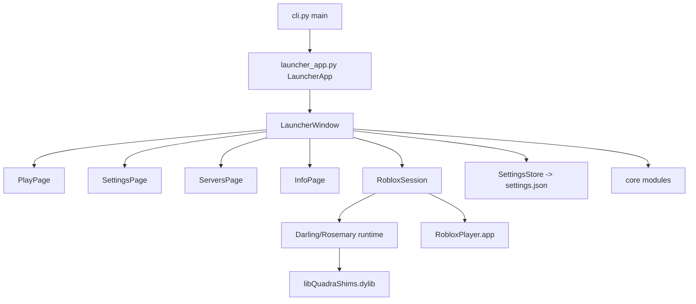
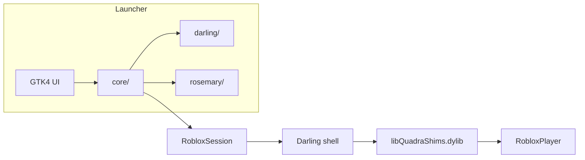

# Quadra Lite — Comprehensive Technical Architecture Report

> Analysis only. No source files were modified to produce this document.

## 1. Project architecture

### Directory and file structure

```
quadra-lite/
├── branding/              # icons, logos, wordmarks
├── darling/               # Darling-only native code
│   ├── shim/              # libQuadraShims.dylib injected into Roblox
│   ├── frameworks/        # stub frameworks (CoreML, CoreHaptics, DeviceCheck)
│   └── metal-vulkan/      # Quadra M2VK (Metal-on-Vulkan) build
├── launcher/quadra/       # Python/GTK4 launcher
│   ├── core/              # headless core (installing/preparing/running Roblox)
│   ├── darling/           # Darling-runtime launcher code
│   ├── rosemary/          # Rosemary-runtime launcher code
│   └── ui/                # GTK4/libadwaita interface
├── rosemary/              # Rosemary-native helpers (README only)
├── tests/                 # Python + native tests
├── install.sh             # source installer
├── uninstall.sh           # wrapper -> install.sh --uninstall
├── build_debug_shim.sh    # builds the Darling shim
├── run_debug.sh
├── quadralite-installer.c # tiny downloader binary source
└── quadralite-installer   # compiled binary (release asset)
```

### Purpose of every major module

- `core/` — headless Roblox lifecycle (no GTK).
- `core/locations.py` — all paths, bundle, runtime, prefix.
- `core/config.py` — settings defaults/load/save.
- `core/session.py` — `RobloxSession`: prepare/start/watch one run.
- `core/roblox.py` — client version, download, patches, delete.
- `core/builds.py` — shim + Metal build, tool checks.
- `core/launcher_update.py` — self-update from GitHub.
- `core/darling_server.py` — Darling container env/server.
- `core/process_control.py` — find/stop/prioritize processes.
- `core/audio.py` — host audio playback (pacat/pw-cat).
- `core/account.py` — saved sign-in, sign-out.
- `core/prefix_files.py` — files installed into Darling prefix.
- `core/host.py` — host icon, VRAM.
- `core/x11.py` — X display discovery.
- `core/fast_flags.py` — user + Darling-required fast flags.
- `core/files.py` — atomic file writes.
- `core/logs.py` — log reading/cleanup.
- `core/server_location.py` — game server IP/location.
- `core/state.py` — `SettingsStore` (watch/stage/save).
- `core/desktop.py` — CiderDarling desktop shortcut.
- `darling/` — Darling-only launcher code (runtime install/updates, patches, web bridge, stallwatch).
- `rosemary/` — Rosemary install/runtime.
- `ui/` — GTK4/libadwaita pages.
- `gpus.py` — GPU inventory/selection.
- `graphics.py` — renderer env, Vulkan/Metal, VRAM cap.
- `display.py` — DPI scale, window env.
- `dns.py` — DNS forwarder.
- `transport_monitor.py` — RakNet transport detection.
- `hardware_report.py`, `diagnostics.py` — reports.
- `i18n.py` — translations (en/ru/zh).
- `paths.py` — XDG user dirs (`quadralite`).
- `game_info.py` — Roblox game metadata + cache.
- `activity.py`, `history.py`, `region.py` — activity tracking, server history, region join.

### Entry points and execution flow

- `launcher/quadra/cli.py::main()` — CLI entry (`quadralite`).
- `launcher/quadra/ui/launcher_app.py::main()` — GTK application (`LauncherApp`).
- `install.sh` — installer/updater/uninstaller.
- `build_debug_shim.sh` — builds `libQuadraShims.dylib`.

High-level flow:

```
quadralite (cli.py)
  -> uri.receive (if a Roblox URI is passed)
  -> launcher_app.main()
       -> LauncherApp.do_activate()
            -> LauncherWindow(...)
            -> if needs_window: present_settings() else autostart()
```

---

## 2. Launcher internals

### GTK4 application architecture

- `launcher_app.py::LauncherApp` (Adw.Application). `do_activate` builds `LauncherWindow`, decides `present_settings()` vs `autostart()`.
- `launcher_window.py::LauncherWindow` (Adw.ApplicationWindow) holds the `Adw.ViewStack` of pages: Play, Settings, Servers, Info. Sidebar via `OverlaySplitView`.
- Pages are `Adw.PreferencesPage`/custom bins created in `build()`.

### Window, pages, settings and navigation

- `play_page.py::PlayPage` — Play button, dashboard facts (Roblox version, renderer, runtime, GPU), logs.
- `settings_page.py::SettingsPage` — Environment/Roblox/M2VK/Fast flags tabs, runtime choice.
- `servers_page.py` — server rejoin/history.
- `info_page.py` — about/contributors.
- `flags_page.py` — fast flags editor.
- `boot_splash.py` — splash during launch.

### How UI components communicate

- `LauncherWindow.watch_setting(keys, callback)` subscribes to settings changes via `SettingsStore.watch`.
- `activity_changes` / `client_changes` Subscribers notify pages.
- Pages hold `self.window` reference and call `window.set_setting`, `window.begin`/`end` for busy operations.

### State management and configuration persistence

- `core/state.py::SettingsStore` wraps a dict with `watch`/`stage`/`save`/`snapshot`. Watchers fire on change; `stage` notifies without saving until `save()`.
- `core/config.py` provides `DEFAULT_SETTINGS`, `load_settings()`, `save_settings()`. Validation per key type; `launcher_appearance` restricted to `gnome`.
- Settings persisted to `~/.config/quadralite/settings.json`.

---

## 3. Roblox installation and launching

### Installation and update mechanisms

- `core/roblox.py`: `installed_version()`, `latest_version(channel)`, `version_is_newer()`, `install_update()`, `clear_roblox_cache()`, `delete_roblox()`, `sign_out()`.
- Download URL template: `https://setup.rbxcdn.com/mac/{upload}-RobloxPlayer.zip` (Mac player). Version from `clientsettingscdn.roblox.com/v2/client-version/MacPlayer`.
- Channel support (`roblox_channel`).
- `roblox_downloads.py` handles downloads.

### How Roblox is started

`RobloxSession.start()` → `_start()`:

1. `builds.missing_tools()` check.
2. Renderer deps (vulkan/metal).
3. Metal build if needed.
4. `environment()` → Darling env + graphics env + GPU env.
5. X11 check.
6. Renderer validation (vulkan/metal).
7. Process cleanup (leftover Roblox, orphaned Darling).
8. Metal shader preload (optional).
9. `prefix_files.prepare_prefix(env)`.
10. DNS forwarder if configured.
11. Audio host.
12. Darling server prepare.
13. `subprocess.Popen(darling shell /bin/bash -c LAUNCH_SCRIPT ...)` with shim env vars.

`LAUNCH_SCRIPT` exports `DYLD_INSERT_LIBRARIES=libQuadraShims.dylib`, `DYLD_FORCE_FLAT_NAMESPACE=1`, runs `RobloxPlayer -protocolString <uri>`.

### How the launcher detects whether Roblox is running

- `RobloxSession.poll()`: checks `process.poll()`, `roblox_pids(("RobloxPlayer",))`, `QUIT_SENTINEL` file, gone-since timing. Returns None while running, else status.
- `process_control.roblox_pids()` scans `/proc`.

### Environment variables

`shim_variables()` emits ~40 `QUADRA_*` vars: mouse/scroll sensitivity, DPI, VRAM, DNS, audio FIFO, framerate cap, web socket, trace flags, `QUADRA_PENDING_URI_FILE`, `QUADRA_QUIT_SENTINEL`, `QUADRA_ICON_ARGB`, plus CiderDarling vars. Graphics env adds renderer/Metal/GPU/MangoHud/Wayland vars.

---

## 4. Runtime architecture

### How Rosemary works

- `rosemary/runtime.py::RosemarySession` (extends RobloxSession). Installs/downloads Rosemary via `rosemary/install.py`. Finds binary with `find_rosemary()`. Applies fast flags. Runs on OpenGL/Metal.
- `rosemary/client.py` — client download helpers.
- Supports `rosemary_source` ("quadra"/"upstream"), pinned builds, rollback.

### How Darling works

- `darling/runtime.py` — `resolve_runtime()`, installed runtimes, prefix creation.
- `darling/runtime_install.py`, `runtime_updates.py` — install/update Darling releases.
- `darling_server.py` — Darling container env, server start/restart, version.

### How runtime installation, updates and switching work

- `locations.DARLING_RUNTIME = resolve_runtime()` at import. Settings `runtime_backend` ("rosemary"/"darling"). `backends.py` defines feature sets per runtime; UI greys out unsupported settings.
- `settings_page` has runtime choice combo, install/update/rollback buttons.
- Switching Darling runtime triggers `system._restart_launcher()`.

### How the injected shim communicates with the runtime

- `libQuadraShims.dylib` injected via `DYLD_INSERT_LIBRARIES`. Communicates via env vars (`QUADRA_*`) and files (pending-uri, quit-sentinel, icon argb). C code in `darling/shim/` (net_trace, audio_hal, raw_mouse, etc.).

---

## 5. Graphics and hardware

### Renderer architecture

- `opengl` (default), `vulkan` (Zink), `metal` (Quadra M2VK).
- `graphics.py`: `renderer_environment()`, `metal_environment()`, `metal_vram_cap()`, `metal_tuning_environment()`, `validate_vulkan()`, `validate_metal()`, `ensure_vulkan_dependencies()`, `missing_metal_dependencies()`.

### Vulkan/Metal implementation

- Metal (Quadra M2VK): `darling/metal-vulkan/build.sh` builds `Metal.framework` + host library. Shader preload (`metal_preload.py`), stage progress, diagnostics. Fallback to OpenGL on failure (`metal_fallback`).

### GPU detection

- `gpus.py::enumerate_gpus()` reads `/sys/class/drm`, PCI addresses, vendor/product, driver, render nodes. NVIDIA name from `/proc/driver/nvidia/gpus`. `selected_gpu(selection)` picks adapter. `gpu_environment()` sets PRIME/Vulkan ICD vars.

### Fast flags and graphics settings

- `core/fast_flags.py`: user flags + Darling-required flags merged into `ClientAppSettings.json`. `fflag_allowlist.py` fetches allowed flag list from Roblox.

### Hardware compatibility checks

- `host.py::host_vram_bytes()` reads DRM vram. `hardware_report.py` runs GPU/MSAA/CPU tests. `builds.missing_tools()` checks clang/lld/etc.

---

## 6. Networking

### DNS override implementation

- `dns.py` (root): `DnsForwarder` runs a local DNS forwarder; `TELEMETRY_DOMAINS` list. `dns.parse_server()`. Settings: `dns` (system/quad9/cloudflare/google/custom), `dns_custom`, `block_telemetry`.

### Telemetry blocking

- When `block_telemetry`, forwarder answers Roblox telemetry hosts with NXDOMAIN. Requires non-system DNS.

### Server location functionality

- `core/server_location.py`: reads game log for server IP, queries RoValra (`apis.rovalra.com`) for location. `server_location_lookup`, `server_location_notify`. `history.py` records servers.

### Network-related dependencies

- `urllib.request` for HTTP. `region.py` for region picking (RoValra server list).

---

## 7. Diagnostics and error handling

### Logging architecture

- `core/logs.py`: cleanup, read. Session writes `logs/launch-*.log` with lifecycle records. Trace files for CiderDarling.
- `QUADRA_*` trace env vars enable diagnostic signals, UDP/lock/event/GL/key tracing, FPS log.
- `keep_logs` setting limits retention.

### Crash detection

- `RobloxSession.poll()` detects disappearance, quit sentinel, frontend exit.
- `process_control._kill_crash_handlers()` kills RobloxCrashHandler.
- `_suppress_crash_handler` thread.
- Transport monitor detects RakNet breakage (Error 256).

### Diagnostic reports

- `diagnostics.py::collect` writes an archive. `hardware_report.py` runs GPU tests. `launcher_window.collect_diagnostics()` / `collect_hardware_report()`.
- Last error saved to `~/.cache/quadralite/last-error.txt`.

### Recovery mechanisms

- Metal fallback to OpenGL. Orphaned Darling cleanup. Darling server restart if foreign. Process cleanup before launch. Runtime rollback (`previous_build`).

---

## 8. Updates and distribution

### Launcher auto-updater

- `core/launcher_update.py::check_launcher_update()` queries GitHub releases API. `update_launcher()` git fetch+merge --ff-only, rebuild shim if Darling, run install.sh. Returns (True, msg) or (False, url).

### Installer architecture

- `install.sh`: downloads repo to `~/.local/share/QuadraLite`, installs menu entries/icons via `launcher/install.sh`, desktop entries (`io.github.schlabbadabadoo.QuadraLite*.desktop`), wrapper `~/.local/bin/quadralite`.
- `install-runtime.sh`: installs Darling/Rosemary runtime.
- `uninstall.sh` → `install.sh --uninstall` (purge option).

### GitHub release integration

- Release tag `v0.43.2-lite` with assets `install.sh`, `quadralite-installer`, `SHA256SUMS`. gh CLI configured.

### Version management and rollback support

- `__version__` in `launcher/quadra/__init__.py` (0.43.2). Git tags. Rosemary pinned builds / previous build rollback.

---

## 9. Dependencies

### Python packages

- PyGObject (gi), GTK4, libadwaita, WebKitGTK 6 (launcher only).
- Standard library: json, subprocess, urllib, threading, etc.

### System dependencies

- Python 3, git, clang, lld, unzip, GTK4, libadwaita, WebKitGTK 6.
- Darling runtime (installed by setup).
- pacat/pw-cat for audio.

### Native libraries

- `libQuadraShims.dylib` (Darling shim).
- `libquadra_metal_host.so`, `Metal.framework` (Quadra M2VK).
- Stub frameworks: CoreML, CoreHaptics, DeviceCheck.

### External binaries and runtime requirements

- `darling` (or `ciderdarling`), `rosemary` (optional), `clang`, `lld`, `git`, `curl`, `unzip`, `pacat`/`pw-cat`, `lspci`, `taskset`.

---

## 10. Testing

### Existing test coverage

- 318 Python unit tests in `tests/` + `tests/launcher/`.
- `tests/run.sh` builds native fixtures (clang) then runs Python tests.
- Coverage: settings store, paths, config, backends, gpus, dns, history, activity, logevents, fflag_allowlist, game_info, appearance, state sync, transport, etc.
- Package layout test enforces `__all__` consistency in `core/` and `ui/`.

### Important untested systems

- Roblox actual launch (requires Darling + Roblox).
- Metal/Vulkan renderers (GPU-dependent).
- DNS forwarder end-to-end.
- UI GTK interactions (need Xvfb).
- Installer integration.

### How to run the test suite

```
PYTHONPATH=launcher python3 -m unittest discover -s tests -p '*_test.py'
```

Native fixtures: `bash tests/run.sh`.

---

## 11. Technical debt and improvement opportunities

### Duplicated code

- `core/` and `ui/` namespace sharing via `namespace.share_names` (complex but intentional).
- Renderer logic split across `graphics.py`, `session.py`, `play_page.py`.

### Tightly coupled modules

- `launcher_window.py` is large (1900+ lines) and coordinates everything.
- `settings_page.py` (2400+ lines) mixes all tabs.
- Pages hold `self.window` and call into it.

### Potential architectural problems

- `locations.py` computes `DATA_DIR` at import based on writability (checkout vs installed). Can cause confusion.
- `paths.py` cached with `lru_cache` on `user_directory` — env changes after import ignored.
- Global `namespace.share_names` makes module attributes shared, hard to trace.

### Performance bottlenecks

- `enumerate_gpus()` runs `lspci` with 1s timeout.
- Metal shader preload can take long.
- Log polling every second in `_watch`.

### Security and reliability concerns

- `LAUNCH_SCRIPT` uses shell with env vars; URI passed opaquely (good).
- `install.sh` runs as user, downloads from GitHub (trust).
- DNS forwarder binds local port.
- `allow_debugger` gates ptrace.
- Shim injected via DYLD_INSERT_LIBRARIES (standard for Darling).

---

## Complete architecture overview





---

## 10 most important improvement opportunities

1. Split `launcher_window.py` and `settings_page.py` into smaller modules.
2. Extract a hardware-detection/recommendation module (GPU, Vulkan, RAM) used by both UI and session.
3. Add runtime health checks before launch (verify binary, prefix, shim exist).
4. Separate launcher self-update from Roblox/runtime updates in the UI (already partially).
5. Add crash recovery: detect failed launches and offer recovery (reinstall runtime, rebuild shim).
6. Add config export/import (backup settings).
7. Add GameMode/MangoHud integration toggles (MangoHud already supported; GameMode not).
8. Improve Play page dashboard (GPU, runtime version, last session, health) — partially done.
9. Add checksums verification for downloaded runtimes/installers.
10. Reduce `namespace.share_names` magic; use explicit imports.

---

## Files safest to modify independently

- `README.md`, `CONTRIBUTING.md`, `CLAUDE.md`
- `launcher/quadra/i18n.py` (translations)
- `tests/*.py` (test-only)
- `branding/` assets
- `quadralite-installer.c`
- New modules added under `launcher/quadra/` that don't touch `core/__init__.py`/`ui/__init__.py`

---

## Files that should be modified carefully (affect multiple systems)

- `launcher/quadra/core/locations.py` — paths used everywhere.
- `launcher/quadra/core/config.py` — settings keys consumed across launcher/session/UI/tests.
- `launcher/quadra/core/session.py` — launch flow; breakage stops all launching.
- `launcher/quadra/core/__init__.py` / `ui/__init__.py` — namespace sharing; must list all modules.
- `launcher/quadra/ui/launcher_window.py` — central coordinator.
- `launcher/quadra/ui/launcher_app.py` — app lifecycle/autostart.
- `launcher/quadra/core/roblox.py` — install/update/version.
- `launcher/quadra/backends.py` — feature gating used by settings UI.
- `launcher/quadra/paths.py` — user dirs (cached).
- `build_debug_shim.sh` / `darling/shim/*` — native shim; affects all Darling runs.
- `install.sh` — installer; affects distribution.
